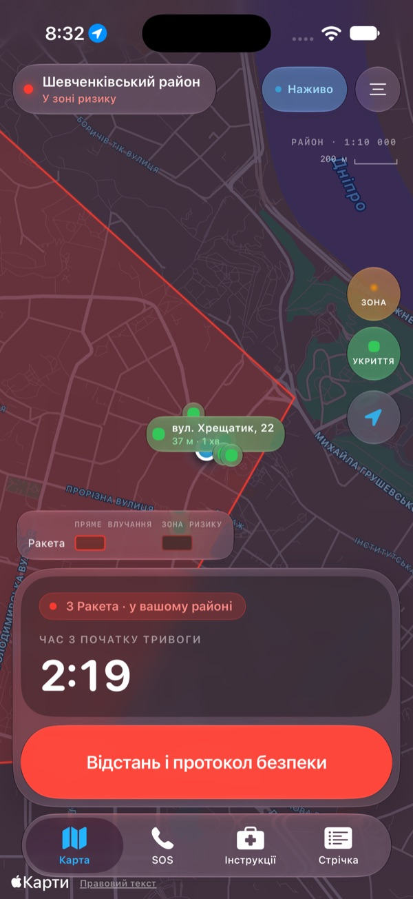
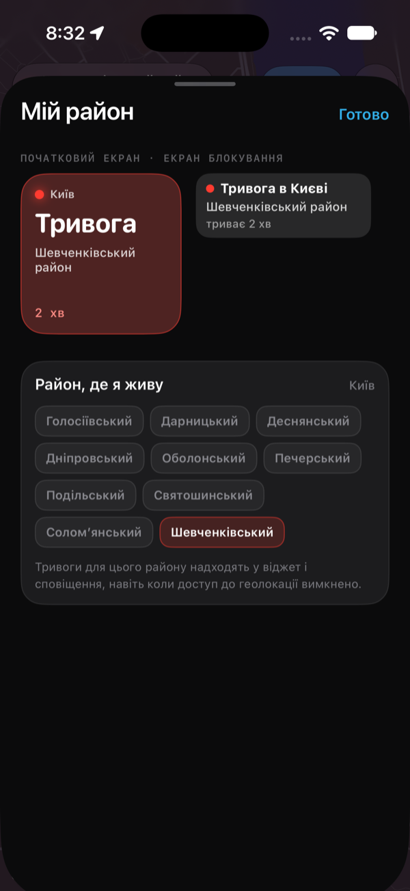
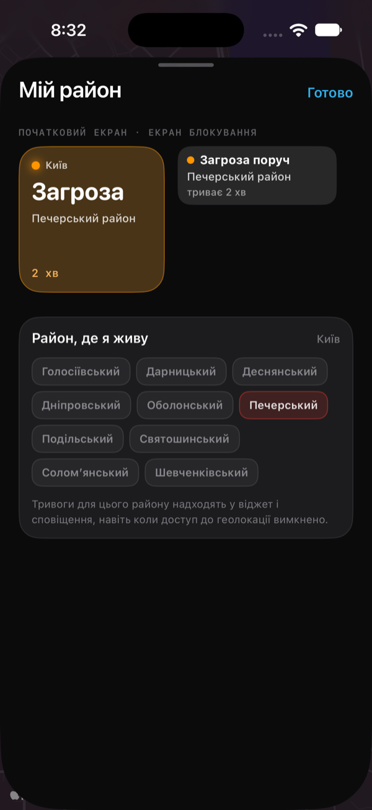
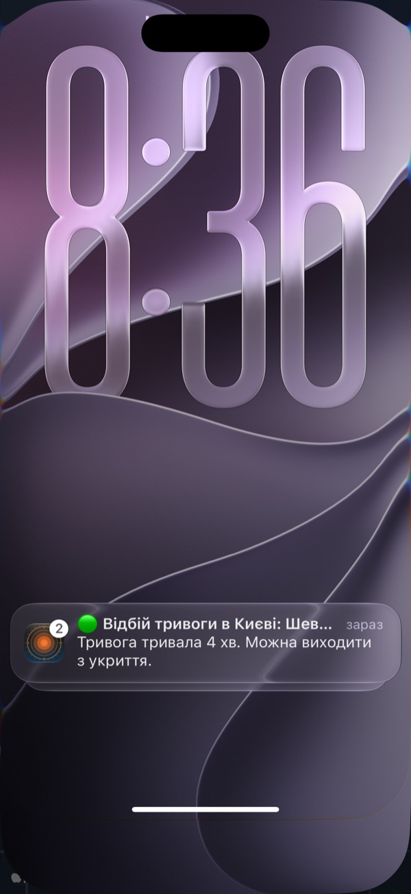
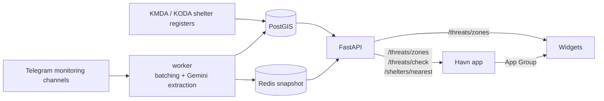

# Havn

**An air-raid threat radar for civilians in Kyiv.** Havn is a SwiftUI app for iOS. It shows where a reported threat is and where it is heading, finds the nearest official shelter by walking time, and tells you whether an alert is on in the district you live in. It is in Ukrainian and English.

<p align="center">
  
  
  
  
</p>

> [!WARNING]
> Havn is **not** an official warning system. Threats are extracted automatically from public monitoring channels and can be late, incomplete or wrong. Always follow the official air-raid siren, the official alert app and the State Emergency Service (DSNS).

## Features

- **Radar map.** Live threat zones from the backend:
  - the direct-hit area, drawn dense;
  - the precautionary buffer and approach corridor, drawn as a pale wash;
  - one colour per threat type: missile, Shahed, recon.
  
  A timer counts up from the first report and stays steady across overlapping reports.
- **Am I in danger.** Your position is checked against the server's own point-in-polygon test. The answer is clear, elevated or high risk.
- **Nearest shelter.** Shelters come from the official Kyiv city (KMDA) and Kyiv oblast (KODA) registers. They are ranked by walking time and show whether they are open right now, which way to walk, accessibility, Wi-Fi where the register lists it, and a phone number you can tap. You can report a wrong entry.
- **My District.** Pick the district you live in. A home screen widget, a lock screen widget and notifications then say **Alert**, **Threat nearby** or **All clear** for that district. This works with location access off.
- **Live Activity.** The current threat goes on the lock screen and in the Dynamic Island.
- **SOS.** One-tap emergency numbers, plus your own emergency contacts with an "I'm safe" message.
- **Guides.** Short offline emergency guides, based on DSNS guidance.
- **Feed.** The reports behind the map, de-duplicated. *Still sample data, see the roadmap.*

### Widgets

| Widget | Sizes | Data |
|---|---|---|
| My District | home small, lock screen rectangular | live: fetches `/threats/zones` itself every ~15 min |
| Nearest Shelter | home small, lock screen rectangular | live, written by the app |
| Location Safety | home small, lock screen circular | sample |

## How it works



The backend lives in [Havn-Backend](https://github.com/ShadowPlayer34/Havn-Backend). It does three things:

- turns monitoring-channel messages into threat clusters with district geometry;
- serves the map overlay with no coordinates needed;
- answers point queries from an in-process spatial index.

The app polls the overlay every 30 s, revalidating with an ETag. It asks about your own position separately.

## Getting started

**Requirements:** Xcode 26 or newer, an iOS 26+ simulator or device, and Docker for the backend.

### 1. Backend

```bash
git clone https://github.com/ShadowPlayer34/Havn-Backend.git AlertRadarBackend
cd AlertRadarBackend
cp .env.example .env        # Gemini + Telegram credentials, see that repo's README
docker compose up -d
python3 scripts/fetch_kyiv_shelters.py
python3 scripts/fetch_kyiv_oblast_shelters.py
docker compose exec worker python scripts/load_shelters.py --replace data/kyiv_shelters.geojson
docker compose exec worker python scripts/load_shelters.py --replace data/kyiv_oblast_shelters.geojson
```

The API comes up on `http://127.0.0.1:8000`.

To see the alert states without waiting for a real threat:

```bash
docker compose exec worker python scripts/seed_demo_threats.py red     # missile over Shevchenkivskyi
docker compose exec worker python scripts/seed_demo_threats.py clear   # remove the demo rows
```

### 2. App

1. Open `AlertRadar.xcodeproj` and choose the **AlertRadar** scheme.
2. Under *Signing & Capabilities*, set your own team for both targets.
3. Change the App Group `group.com.vectoralert.alertradar` to one your team owns. Change it in both entitlements files in `WidgetSupport/` and in `WidgetSnapshotStore.appGroup`.
4. Run on an iOS 26+ simulator.

The app and the widget extension both talk to `http://127.0.0.1:8000` by default. To point them at another server, set `ThreatAPIBaseURL` in each target's Info.plist. A real iPhone needs an address it can reach.

## Project layout

| Path | What's there |
|---|---|
| `AlertRadar/` | The app: `Screens`, `Map`, `Models`, `Services` (networking, location), `ViewModels`, `DesignSystem`, string catalogs |
| `AlertRadarWidgets/` | Widget extension: Live Activity, My District, Nearest Shelter, Location Safety |
| `Shared/` | Compiled into both targets: design tokens, App Group stores, Kyiv districts, API config |
| `WidgetSupport/` | Entitlements and the extension's Info.plist |
| `ROADMAP.md` | What's done, what's next, and why |

## Status

- Phase 0, the MVP, is complete. Phase 1, Kyiv polish, is in progress. See [ROADMAP.md](ROADMAP.md).
- Notifications are local for now: they fire only while the app is running.
- Real push over APNs is roadmap item 1.2. It needs a paid Apple Developer Program account.
