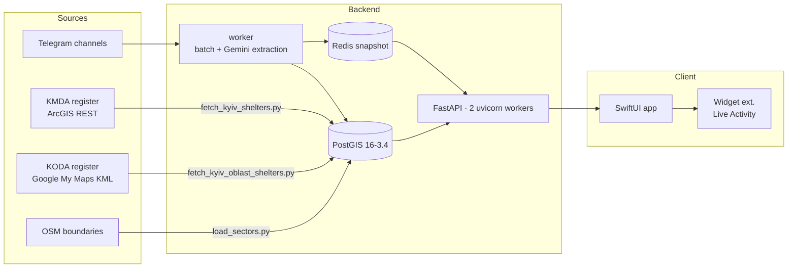
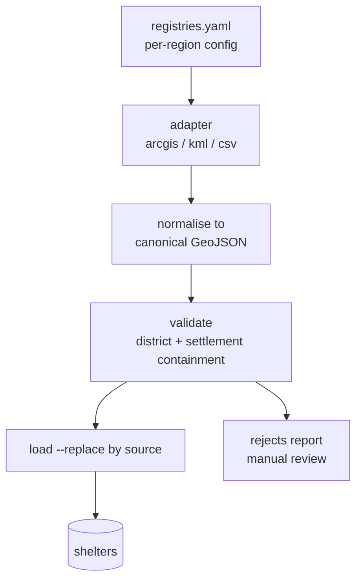

# AlertRadar — Roadmap

Tracking document for `AlertRadar` (SwiftUI/iOS) + `AlertRadarBackend` (FastAPI/PostGIS).
Launch region: **Kyiv city + Kyiv oblast**.

| Phase | Status | Done |
|---|---|---|
| 0 — MVP foundation | ✅ complete | 41 / 41 |
| 1 — Kyiv polish & UX completion | 🔨 in progress | 10 / 33 |
| 2 — National rollout & resilience | ⬜ not started | 0 / 24 |
| 3 — Production hardening | ⬜ not started | 0 / 31 |
| Cross-cutting — data quality & trust | 🔁 ongoing | 5 / 9 |

> **Corrections to the original brief.** Shelters are official-register **only** — the OSM
> data was deleted (`amenity=shelter` was bus stops and gazebos; `military=bunker` was WWII
> pillboxes). "Wire iOS to `/shelters/nearest`" is already shipped. `LocationManager` is
> **not** consolidated — two CoreLocation wrappers still exist (task 1.4). The "<5 ms" KNN
> figure was a cross-container round trip; server-side execution is 1.07–1.28 ms.
> `/threats/active/geometry` shipped as `/threats/zones` — same payload, one endpoint,
> so task 1.1 counts it done rather than adding a second URL for the same bytes.

---

## Architecture



**Hot path:** `/threats/check` is answered from a process-local Shapely `STRtree` rebuilt from
a Redis snapshot — no DB round trip. `/shelters/nearest` goes straight to PostGIS; the data is
static and the GiST KNN is sub-millisecond.

---

## Phase 0 — MVP foundation ✅

### 0.1 Backend core
- [x] FastAPI app, ORJSON responses, lifespan-managed engine/redis
- [x] PostGIS 16-3.4 + Redis + worker via `docker compose`
- [x] SQLAlchemy 2.0 async models: `sectors`, `active_threats`, `threat_history`, `shelters`, `shelter_reports`
- [x] Schema bootstrap from metadata (`app/bootstrap.py`)
- [x] Typed settings from env/`.env` (`app/config.py`)

### 0.2 Threat pipeline
- [x] Telegram ingestion with batching window (`app/worker.py`)
- [x] Gemini extraction → structured `ExtractedThreat`
- [x] Sector resolution: exact → alias → trigram fuzzy (`app/geo.py`)
- [x] Risk geometry: district core + directional corridor + buffer
- [x] Dedup upsert with advisory lock; count/confidence take the max
- [x] TTL expiry + all-clear ("відбій") path + janitor archiving to `threat_history`
- [x] Redis snapshot publish + versioned refresh loop
- [x] In-process `STRtree` index with PostGIS cold-start fallback

### 0.3 Shelter data
- [x] `fetch_kyiv_shelters.py` — KMDA ArcGIS register (4,053 current of 4,634)
- [x] `fetch_kyiv_oblast_shelters.py` — KODA register via Google My Maps KML (1,464)
- [x] Two-adapter loader, `--replace` scoped per source
- [x] Retired entries (`actual != 1`) skipped at load
- [x] District cross-validation — rejects coordinates contradicting their address by >10 km
- [x] District label auto-correction from boundary polygons (706 corrected)
- [x] `ANALYZE` after bulk load (stale stats were pushing KNN off the index)
- [x] `OFFICIAL_SOURCES` enforced at load **and** at query time

### 0.4 Shelter API
- [x] `GET /api/v1/shelters/nearest` — GiST KNN + exact spheroidal re-sort
- [x] Full register detail: address, hours, phone, accessibility, district, source
- [x] Location-based dedupe (register lists one doorway up to 85 times)
- [x] `POST /api/v1/shelters/{id}/report` — 202/404/429, per-device dedupe
- [x] Report counts aggregate by **place**, not row id

### 0.5 iOS client
- [x] `ThreatViewModel` (`@Observable`, `@MainActor`) shared via `@Environment`
- [x] Debounced checks (50 m / 30 s) + force refresh
- [x] Strict `RiskLevel` decoding — unknown level throws, never a false green
- [x] `lastGoodResponse` separate from `state` (failed refresh keeps last known risk)
- [x] MapKit map, risk overlay, truthful scale bar, recenter control
- [x] Live shelter pins from the API + tap-through detail sheet
- [x] Report-a-problem flow with corroboration threshold + local "already reported" state
- [x] Threat dashboard screen (status card, detail rows, map, pull-to-refresh)
- [x] Live Activity + all three Dynamic Island presentations
- [x] Two home-screen widgets (`systemSmall` + accessory families)
- [x] Design system from the Claude Design document (tokens, Liquid Glass)

### 0.6 Testing
- [x] Smoke suite covering extraction → geometry → upsert → spatial → snapshot → janitor → KNN
- [x] Run-scoped isolation (`run_id` dedup key + marker sector) — deterministic under live ingestion
- [x] Index-usage assertion (a seq scan would pass every other check on a small table)
- [x] Server-side timing assertion (1.07–1.28 ms)

---

## Phase 1 — Kyiv polish & UX completion 🔨

### 1.1 Real threat geometry 🔴 highest value
*Geometry now comes from `GET /api/v1/threats/zones`. The local heat-band generator survives
only as the fallback for "the overlay never loaded but `/check` still says there is something".*

- [x] Topology-preserving simplification tuned to ≤200 vertices — `ZONES_MAX_VERTICES`,
      escalating the tolerance per shape. Runs in Shapely, not PostGIS: it is the same
      GEOS `TopologyPreservingSimplifier` that `ST_SimplifyPreserveTopology` wraps, and
      the overlay is served from the in-process index with no DB round trip
- [x] Add `geometry: GeoJSON | null` to `ThreatCheckResponse` — opt-in via
      `?include_geometry=true`; the default response stays 172 B and `no-store`
- [x] Benchmark payload size against the client's 4 s timeout — `scripts/bench_payload.py`
- [x] `GET /api/v1/threats/active/geometry` for the full map overlay — **shipped as
      `GET /api/v1/threats/zones`**; not duplicated under the planned name
- [x] iOS: decode GeoJSON → `MapPolygon` / `MapMultiPolygon` — `/threats/zones`, ETag-revalidated
- [x] iOS: `core` drawn over a pale `risk` wash, `expires_at` enforced client-side
- [x] iOS: `format_eta_window` ported so the window decays between polls
- [ ] iOS: delete `ThreatScenario` heat-band generation — kept, see the line below
- [x] iOS: keep concentric-ring fallback only when geometry is absent
- [ ] Verify overlay matches the backend's actual polygon on device *(checked in the
      Simulator against the backend's own serialiser output; not yet on hardware)*

### 1.2 Push notifications (APNs)
- [ ] APNs auth key + entitlement + provisioning
- [ ] `device_tokens` table (token, last sector, updated_at — no user identity)
- [ ] `POST /api/v1/devices/register` endpoint
- [ ] Server: on cluster upsert, diff affected sectors → resolve target tokens
- [ ] Duplicate guard: one alert per sector per cluster per 15 min
- [ ] Live Activity **push updates** (countdown survives app termination)
- [ ] iOS: registration + permission priming at the right moment
- [ ] iOS: deep link from notification into the map
- [ ] Test: locked device receives a high-risk transition

### 1.3 Report moderation
*Reports accumulate with nothing consuming them.*

- [ ] `GET /api/v1/admin/shelter-reports?min_reporters=2` (protected)
- [ ] `scripts/review_reports.py` — diff flagged entries against the live register
- [ ] Correction submission path back to KMDA/KODA
- [ ] Runbook: who reviews, how often, what evidence is needed

### 1.4 Consolidate location wrappers
- [ ] Move reverse geocoding + fallback anchor into `LocationManager`
- [ ] Single instance in `ContentView`, injected via `@Environment`
- [ ] Delete `LocationProvider`
- [ ] Verify exactly one `CLLocationManager` at runtime

### 1.5 Remove remaining sample data
- [ ] Clean Feed drawer → real threat/message feed endpoint
- [ ] `SafetyProtocolSheet` stat cards ("Moderate", "88%" are hardcoded)
- [x] Live Activity fed from the live threat data — area, threat, status and window, with
      the arrival block dropped entirely when nothing is inbound
- [x] Widget timeline entries → shared container written by the app — App Group
      `group.com.vectoralert.alertradar`, nearest shelter from `/shelters/nearest`
- [ ] Empty/failure state for regions with no coverage
- [ ] Audit: every number on screen traces to an endpoint

**Exit criteria:** no synthetic geometry on screen · a high-risk transition reaches a locked phone · no hardcoded values in the UI.

---

## Phase 2 — National rollout & resilience ⬜

### 2.1 Scalable shelter ingestion



- [ ] `data/registries.yaml` — source URL, adapter, field map, cadence per region
- [ ] `ArcGISAdapter` (KMDA pattern generalised)
- [ ] `KMLAdapter` (KODA pattern generalised)
- [ ] `CSVAdapter` / `XLSXAdapter` for open-data portals
- [ ] Settlement-centroid reference file (one-off cached geocode) for rural validation
- [ ] Scheduled refresh task in the worker
- [ ] Drift report vs. previous snapshot (added/removed/moved)
- [ ] Onboard Lviv
- [ ] Onboard Kharkiv
- [ ] Onboard Dnipro
- [ ] Onboard Odesa
- [ ] Onboard remaining oblast capitals

### 2.2 Offline shelter cache (iOS)
*The moment this matters most is the moment the network is worst.*

- [ ] SwiftData model mirroring `ShelterOut`
- [ ] Seed on first launch; refresh opportunistically on good network
- [ ] Region-bounded prefetch (~50 km around last fix, size-capped)
- [ ] Local KNN fallback when the endpoint times out
- [ ] Staleness indicator ("offline copy, updated 3 days ago")
- [ ] Test: airplane mode still answers "nearest shelter"

### 2.3 Live updates (SSE)
- [ ] `GET /api/v1/threats/stream` publishing snapshot-version bumps
- [ ] Redis pub/sub fan-out so both uvicorn workers push
- [ ] iOS `URLSession.bytes` consumer with exponential backoff
- [ ] Fall back to polling on repeated failure
- [ ] Verify through the reverse proxy (buffering off)
- [ ] Battery measurement vs. current polling

**Exit criteria:** three additional oblasts live · app answers with the network off · threat changes reach a foreground app in <2 s.

---

## Phase 3 — Production hardening ⬜

### 3.1 Edge & TLS
- [ ] Caddy in front of uvicorn (automatic ACME)
- [ ] HSTS + HTTP/2; SSE buffering disabled
- [ ] Per-IP rate limits on read endpoints
- [ ] Per-`client_id` edge limit on reports (complements the in-app limit)
- [ ] Request-size and timeout caps

### 3.2 Secrets & config
- [ ] Move `.env` to a secret store
- [ ] Rotate Telegram session + Gemini key
- [ ] Separate staging/production configuration
- [ ] Document the base-URL override for client builds

### 3.3 Observability
- [ ] `/metrics` Prometheus endpoint
- [ ] Metric: threat-check latency (p50/p95/p99)
- [ ] Metric: index age + snapshot version
- [ ] Metric: KNN duration
- [ ] Metric: LLM refusal/failure rate
- [ ] Metric: ingestion lag (message → live threat)
- [ ] Sentry for API
- [ ] Sentry for iOS
- [ ] Dashboard covering the above

### 3.4 Alerting
- [ ] Index age > 5 min
- [ ] Worker stall / no messages processed
- [ ] Ingestion drift beyond threshold
- [ ] LLM refusal spike
- [ ] Error-rate and latency SLO burn

### 3.5 Data & schema operations
- [ ] Replace `create_all` with Alembic before the first production schema change
- [ ] Nightly `pg_dump` + retention policy
- [ ] Documented restore drill (actually performed once)

### 3.6 CI/CD & load
- [ ] Build + smoke test on PR (suite is already isolated from live data)
- [ ] iOS build + test on PR
- [ ] Container image publishing
- [ ] Load test at 50× burst (air-raid traffic is spiky by nature)
- [ ] Documented deployment + rollback runbook

---

## Cross-cutting — data quality & trust 🔁

*Permanent workstream, not a phase. People act on this data under stress.*

- [x] Strict risk decoding — unknown level throws; never a false green
- [x] Official sources only, enforced at load and at query
- [x] Coordinate/address cross-validation with automatic rejection
- [x] Provenance surfaced in the app (`Kyiv city register` vs `position approximate`)
- [x] User reporting with corroboration threshold (2 reporters) + rate limit (8/hour)
- [ ] Quarterly re-validation sample against an independent geocoder
- [ ] Public data-quality page (coverage, last refresh, known gaps)
- [ ] Reinstall-resistant report identity (needs attestation — weigh against anonymity)
- [ ] Per-region accuracy published alongside the data

### Verified data quality (2026-08)

| Source | Rows | 24/7 | Step-free | Validation |
|---|---|---|---|---|
| `kmda` Kyiv city | 4,053 | 2,983 | 556 | Geocode sample: **median 20 m**, 15/18 within 300 m |
| `koda` Kyiv oblast | 1,464 | 1,002 | 273 | Street-level not possible (OSM sparse); **3.8%** of pins >10 km from own settlement |

---

## Risk register

| Risk | Impact | Mitigation |
|---|---|---|
| Oblast pins imprecise (hand-placed) | User sent to wrong building | Provenance badge · settlement validation (2.1) · reports |
| Register refresh is manual | Stale shelters | Scheduled refresh + drift report (2.1) |
| LLM extraction wrong or refused | Missed or phantom threat | Confidence floor · TTL · all-clear path · refusal logging |
| Single API host | Total outage during a raid | Offline cache (2.2) → multi-AZ |
| Report abuse | Good shelters discredited | Corroboration threshold · rate limit · human review (1.3) |
| Telegram session loss | Ingestion stops silently | Index-age alert (3.4) · documented re-auth |

---

## Sprint sequence

| Sprint | Focus | Ships |
|---|---|---|
| 1 | 1.1 | Real threat polygons on the map |
| 2 | 1.2 | Alerts reach a locked phone |
| 3 | 1.3 · 1.4 · 1.5 | Moderation · one location wrapper · no sample data |
| 4 | 2.1 | Three more oblasts |
| 5 | 2.2 | Works with no network |
| 6 | 2.3 · 3.1 · 3.3 | Live updates · TLS · metrics |

---

## Running the stack

```bash
# backend
cd AlertRadarBackend && docker compose up -d
python3 scripts/fetch_kyiv_shelters.py
python3 scripts/fetch_kyiv_oblast_shelters.py
docker compose exec worker python scripts/load_shelters.py --replace data/kyiv_shelters.geojson
docker compose exec worker python scripts/load_shelters.py --replace data/kyiv_oblast_shelters.geojson
docker compose exec worker python scripts/smoke_test.py

# ios — simulator must run iOS 26+
xcodebuildmcp simulator build-and-run \
  --project-path AlertRadar.xcodeproj --scheme AlertRadar --simulator-name "iPhone 17 Pro"
```

Base URL override: `ThreatAPIBaseURL` in the app's Info.plist (default `http://127.0.0.1:8000`).
